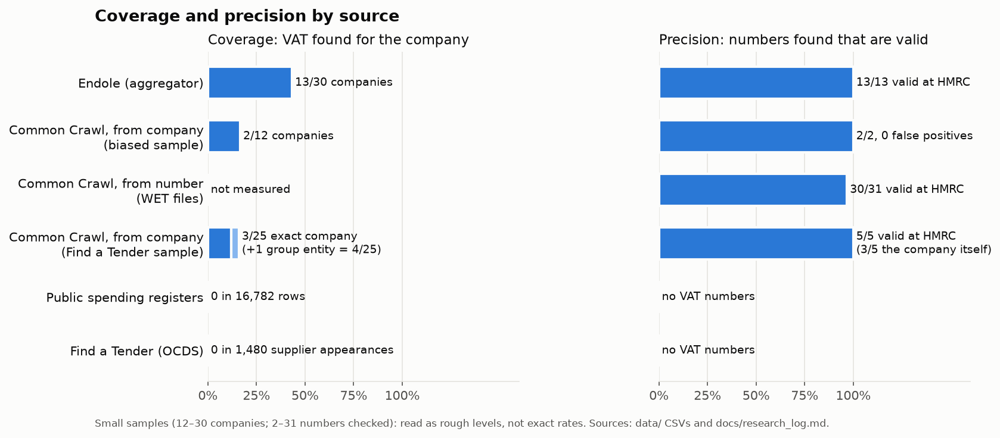
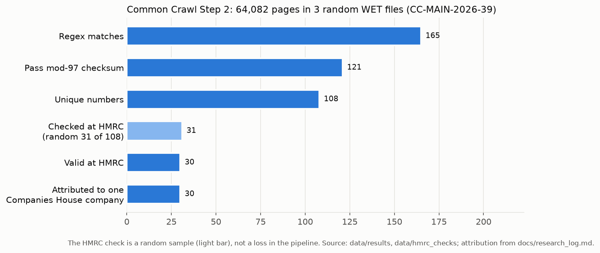
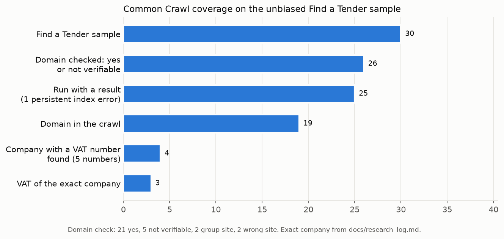

# VAT Identifier Discovery: can a UK company VAT dataset be built from the open web?

Take-home challenge for the Veridion Data Assets internship ("VAT Identifier Discovery", Veridion careers page).
Data and checks as of October 2026. The full research trail, in Romanian, is in
[`docs/research_log.md`](docs/research_log.md); every number below comes from it or from the CSVs in [`data/`](data/).

## TL;DR

**Can a UK VAT dataset be built from the open web? Partially.** The VAT numbers that are on the open web can be
extracted and attributed with high precision, but most companies do not publish theirs, so the open web alone covers
only a minority of suppliers.

- **Precision is high.** From 64,082 random Common Crawl pages, 30 of 31 extracted numbers were valid at HMRC (97%)
  and 30/30 were attributed to a single Companies House company via the HMRC name.
- **Coverage is low.** On an unbiased sample of 25 active companies with a verified website, I found the company's own
  VAT number for 3/25 (12%), or 4/25 (16%) counting a VAT-group case. 24% of the domains were missing from the crawl,
  and most companies simply do not publish the number.
- **Official public sources are dead ends:** 0 VAT numbers in 16,782 local-authority spending rows, 0 in 1,480 Find a
  Tender supplier records, and EORI appears ~100× less often than VAT. Central government collects suppliers' VAT
  numbers but does not publish them.

**What I would do for the client's 40,000 suppliers:**
1. **Common Crawl "from number", run on AWS** next to the data: extract every UK VAT number from legal pages and
   attribute it through the HMRC name. This needs no website per company, but it does need HMRC's production API,
   which a registered organisation can obtain.
2. **Use the ~13,000 VAT numbers the client already has** in two ways: as a validation set, to measure real coverage
   and precision on the client's own suppliers before scaling (and periodically after, as a quality check); and to
   detect VAT groups, where one number covers several suppliers.
3. **Close the gap that the open web cannot**, with licensed commercial data (an aggregator such as Endole covered 43%
   of large companies, 13/13 correct, but its free terms forbid automation) and by asking suppliers directly.
4. **A missing number is better than a wrong one:** every number is validated at HMRC before it enters the dataset,
   and "not found" is reported as such.



---

## Part 1: Research trail

In research order. For every source: what I tried, what I found, why it worked or failed, and the evidence.

### 0. Starting point: where the law requires a VAT number

- **Invoices:** GOV.UK VAT Notice 700/21, section 4.1: every VAT invoice must show the supplier's name, address and
  VAT number. But invoices are private documents, so not an open-web source.
- **Company websites:** Electronic Commerce (EC Directive) Regulations 2002, Regulation 6, point (g): a service provider
  doing VAT-able activity must give its VAT number. My reading: it is not clear that a simple brochure site falls under
  it, so I treated the legal obligation as uncertain and **measured it empirically** instead.
- Evidence: [Step 1 in the log](docs/research_log.md#step-1--setup-și-prima-privire-la-companies-house).

### 1. Companies House bulk data

- **Tried:** the free snapshot `BasicCompanyDataAsOneFile-2026-09-01.csv`, queried with DuckDB.
- **Found:** 5,689,366 rows read in 5.9 s; 1 row rejected (SENTINALL LIMITED has 5 SIC codes, the header has 4).
  **No VAT column.** Early hypothesis "VAT = company number" rejected: company numbers have 8 characters, VAT numbers 9
  digits.
- **Stratification** to separate "no VAT" from "not found": by accounts category, "group 4" (FULL, MEDIUM, GROUP,
  AUDIT EXEMPTION SUBSIDIARY) = **155,632** companies, the ones almost certain to be VAT-registered. By first SIC code:
  dormant / residents' management (231,451), real estate and holding (659,588, uncertain: VAT Notice 742 makes most
  property letting exempt), none supplied (231,523), the rest (4,566,804).
- **Shared addresses:** 61.6% of companies sit at an address shared with ≥ 2 companies, 22.9% at ≥ 100 (top: 71-75
  Shelton Street, 86,448 companies). The HMRC address of the first real case (EC2A 4NE) is itself a service address.
  → **A postcode match is a hint, not proof.**
- **Why it matters:** no VAT, but it is the **join base** (number, name, address, accounts category) for every later
  step.
- Evidence: [`notebooks/01_companies_house_exploration.ipynb`](notebooks/01_companies_house_exploration.ipynb); log
  [Step 1](docs/research_log.md#step-1--setup-și-prima-privire-la-companies-house),
  [Step 3](docs/research_log.md#step-3--primul-caz-real-și-adresele-comune).

### 2. Manual Google search + "VAT" on the company site (abandoned)

- **Tried:** manual Google search for 4 companies from a random sample of 20; `requests` + regex `\bVAT\b` on downloaded
  pages.
- **Found:** the Companies House page of 09115556: 0 "VAT" matches; 4S UK Consulting's contact page: no VAT number.
- **Why I stopped:** (1) it does not scale to millions of companies; (2) the hard part was finding the VAT on the site,
  not finding the site, and one page does not cover the pages where it usually appears; (3) "not found" cannot be
  separated from "company has no VAT".
- Evidence: log [Step 1](docs/research_log.md#step-1--setup-și-prima-privire-la-companies-house).

### 3. HMRC VAT checker (web) and API (Sandbox)

- **Tried:** the web checker "Check a UK VAT number" (manual, no account); an HMRC Developer Hub Sandbox application
  subscribed to "Check a UK VAT number 2.0".
- **Found:** 40/40 Sandbox test numbers → 200 with the same number returned (including 12-digit numbers and leading
  zeros, hence numbers kept as text). `123456789` → 404 NOT_FOUND; `12345` → 400 INVALID_REQUEST. The response has name,
  address and processing date, **no company number**.
- **Why it matters:** HMRC confirms a number but does not find one, and a 200 only says the number exists, not that it
  belongs to the company I am looking for → validation = HMRC valid + name match + postcode as a weaker signal.
- **Production access:** the terms require proof of a registered organisation (Companies House, UTR, VAT, PAYE), a
  privacy policy and software terms. As a student without a company I could not answer honestly, so **real numbers were
  checked by hand on the web page**; the Sandbox code shows the automated check is built and tested.
- Evidence: [`notebooks/02_hmrc_api_sandbox.ipynb`](notebooks/02_hmrc_api_sandbox.ipynb); log
  [Step 2](docs/research_log.md#step-2--hmrc-verificatorul-web-și-api-ul-sandbox).

### 4. Endole (aggregator)

- **Tried:** 30 random group-4 companies; Endole page of each, "VAT Number" field, then HMRC by hand.
- **Found:** VAT shown for **13/30 (43%, 95% Wilson CI 27–61%)**; **13/13 valid** at HMRC on the exact company name
  (0 false positives); postcode match 9/13, and the other 4 have normal causes (HMRC lags after a move, or HMRC holds
  the trading address while Companies House holds the registered office). "Missing" on Endole ≠ no VAT: 8 of the 17
  almost certainly have VAT (assessed by size and activity). Searching the company's group: 0 own VAT numbers in 6
  companies, +40% time. ~2.8 min per company, ~6.5 min per valid VAT found.
- **Why not used:** coverage limited by the source, and **Endole's Terms (2.5) forbid automation**.
- Evidence: [`notebooks/03_endole_sample.ipynb`](notebooks/03_endole_sample.ipynb),
  [`data/hmrc_checks/urma_endole_30.csv`](data/hmrc_checks/urma_endole_30.csv),
  [`docs/notes/endole_30.md`](docs/notes/endole_30.md); log [Step 4](docs/research_log.md#step-4--endole-pe-30-de-firme).

### 5. Common Crawl, Step 1: from company to VAT

- **Where the idea came from:** Common Crawl is not named in the statement; the AI assistant suggested it as a reading of
  the hint "bulk web corpora: crawling site by site may be the wrong shape". The decision to test it, and how, was mine.
- **Tried:** if the website is known, find the VAT in the archive without visiting the site. 12 companies (the 13 with
  VAT confirmed via Endole, minus one without a site); `CC-MAIN-2026-39`.
- **Code trail:**

  | Version | VAT found | What was wrong / fixed |
  |---|---|---|
  | v1 | 1/12 | Index 504 errors counted as "domain absent"; `domain/*` missed `www.`; content not decoded correctly |
  | v2 | 1/12 | Fixed with `matchType=domain`, `warcio`, errors separated from absences (BP3: 0 → 228 pages). PDFs still ignored |
  | v3 | 2/12 | PDF reading (`pypdf`) + tiered prioritisation. Laine found at page 0; in v2, 73 PDFs with "policy" in the name filled the first 30 slots |

- **Found:** 10/12 domains in the crawl; VAT found **2/12** (Laine: PDF Terms; Rope & Sling: Contact page); **0 false
  positives** on the 172 pages read. The company number appears next to the VAT in 2/2. Manual check of live sites:
  **5 of 7 do not publish their VAT number**, including companies with £170M–567M turnover. The Laine PDF is in
  `2026-39` but not in `2026-34`, `2026-30`, `2026-25`.
- **Why it worked / failed:** when the VAT is on the site and the page is in the crawl, the method finds it. The main
  limit is the companies (they do not publish), not the tool; the second is that coverage varies from crawl to crawl.
  **This sample is biased** (chosen because their VAT was known): it tests the method, not coverage.
- Evidence: [`notebooks/04_cc_step1_from_company.ipynb`](notebooks/04_cc_step1_from_company.ipynb),
  [`docs/notes/cc_step1.md`](docs/notes/cc_step1.md); log
  [Step 5](docs/research_log.md#step-5--common-crawl-pasul-1-pornind-de-la-firmă).

### 6. Common Crawl, Step 2: from number to company (WET files)

- **Tried:** extract any UK VAT number from arbitrary pages, then see how often it is right and whose it is. 3 random WET
  files (seed 42) out of 100,000 in `CC-MAIN-2026-39`: 64,082 pages, 1,302 on `.uk` domains. Regex "VAT" + 9 digits
  (and separately "GB" + 9 digits), mod-97 checksum, company number from ±200 characters of context, 31 numbers checked
  at HMRC in random order, attribution by normalised HMRC name looked up in Companies House.
- **Found:**
  - 165 matches → 121 pass the checksum ("VAT" pattern 116/155; "GB" without "VAT" 5/10, noisier) → **108 unique
    numbers** on 106 sites. 74/108 have a company number in context; 72 of them exist in Companies House.
  - **Invalid at HMRC: 1/31 (3.2%; 95% CI ~0.6–16%)**: Charlotte Tilbury, a number the company itself publishes in its
    global footer. Extraction errors: 0/31.
  - **30/30 valid numbers attributed to a single Companies House company.** Two methods compared: company number in the
    page vs HMRC name → same company in 19/21; in **2/21** the HMRC name points to another company (taylormaxwell.co.uk →
    TAYLOR MAXWELL GROUP LTD; veeve.com → UNDER THE DOORMAT LTD).
  - Group-4 companies are 33% of the matches found in Companies House vs 2.7% of the register (possible bias: only
    pages that print the company number).
- **What I concluded:** precision is very high; the **attribution key is the HMRC name**, with the company number on the
  page only as a cross-check; postcode is a weak signal at service addresses; filtering on `.uk` or English would miss
  real numbers (Cochrane, Russian page; Whisky Marketplace, `.sg`); brand names often differ from legal names;
  **coverage is not measured here**.
- Evidence: [`notebooks/05_cc_step2_from_number_wet.ipynb`](notebooks/05_cc_step2_from_number_wet.ipynb),
  [`data/hmrc_checks/cc_pas2_rezultat_hmrc.csv`](data/hmrc_checks/cc_pas2_rezultat_hmrc.csv) (the 30/30 attribution is
  shown in the notebook's attribution-comparison cell); log
  [Step 6](docs/research_log.md#step-6--common-crawl-pasul-2-pornind-de-la-număr).



### 7. Public spending registers

- **Local authorities (payments > £500):** the Local Government Transparency Code 2015 requires date, department,
  beneficiary, purpose, amount, irrecoverable VAT (an *amount*) and merchant category, **not the supplier's VAT
  number**. Empirical check, June 2026: Dorset 11,113 rows (5,776 redacted, 52%) and Kirklees 5,669 rows (953 redacted,
  17%). **0 VAT numbers in 16,782 rows.** The 6 checksum-passing 9-digit numbers at Kirklees were 4 code artefacts and 2
  reference numbers. Kirklees adds a company number for 396 of 1,219 suppliers (32%).
- **Central government (> £25,000):** HM Treasury "Guidance for publishing spend over £25,000": field 15, supplier "VAT
  Registration Number", is **collected but "Not to be published until requested by the Treasury"** (checked in the PDF,
  p. 8 and p. 14). A dead end by policy decision, not by lack of data.
- **Other observations:** the Dorset site refused access from Romania on one attempt; the checksum alone gives false
  positives on reference numbers, so the number must appear next to the word "VAT".
- Evidence: [`notebooks/06_public_spending_registers.ipynb`](notebooks/06_public_spending_registers.ipynb),
  [`data/registre/`](data/registre/); log [Step 7](docs/research_log.md#step-7--registre-publice-de-cheltuieli).

### 8. Find a Tender (OCDS API)

- **Tried:** the public OCDS 1.1.5 API (Open Government Licence v3), award notices.
- **Found:** 500 contracts (September 2026): 1,480 supplier appearances; main identifier GB-COH 49%, missing 48%, GB-NHS
  2%; `additionalIdentifiers`: 0; **GB-VAT: 0** (the OCDS documentation example is only illustrative). Over 1,371
  unique suppliers: company number 51%, website 38%, both 32%.
- **Sampling for the next step, and the bias found:**
  - Attempt 1 (30 suppliers straight from the 436 with company number + website): 26/30 in the care sector, because
    **26 of 500 contracts (5%) are framework agreements holding 61% of supplier appearances** (up to 76 suppliers
    each). Abandoned.
  - Attempt 2 (one supplier per contract, CPV 85 excluded, 1,000 contracts): only 10 eligible; in 3 of 10 the
    `details.url` was not the supplier's site.
  - Attempt 3 (6,000 award notices Jan–Sep 2026; one supplier per contract; no CPV 85, no .gov/.ac/.nhs sites; seed
    42): CPV 85 = 36% of contracts; only **48 of 3,826 (1.3%)** have a supplier with company number + website. Sample
    of 30: 14 CPV divisions, 17 large / 13 SME; **company numbers correct 30/30**.
- **Why it failed for VAT / what it gives:** no VAT numbers; a good adjacent identifier (company number for ~50% of
  suppliers, correct 30/30, open licence); the website field is unreliable.
- Evidence: [`notebooks/07_find_a_tender.ipynb`](notebooks/07_find_a_tender.ipynb),
  [`data/samples/fat_esantion_30_v3.csv`](data/samples/fat_esantion_30_v3.csv); log
  [Step 8](docs/research_log.md#step-8--achiziții-publice-find-a-tender-api-ocds).

### 9. Common Crawl on the unbiased Find a Tender sample (coverage)

- **Tried:** the Step 1 method on companies chosen **without** any link to a VAT source; the right answer was not known in
  advance, so every valid number was collected and checked at HMRC.
- **Found:** 26 companies run, 1 persistent server error → **25 with a result**. Control: Ford Retail and Instep (VAT
  visible on the first page) found at the first page read. **Domains in the crawl 19/25 (76%).** VAT found for 4/25
  companies, **5 numbers, all valid at HMRC**. Attribution by HMRC name: 3 exact (Ford Retail, Instep, TLT LLP); 1
  another group entity (Carter Jonas LLP → CARTER JONAS SERVICE COMPANY, a separate active company at the same address,
  probably a VAT group); 1 another entity on the same page (TLT (NI) LLP, correctly not attributed).
  **Coverage 12% (3/25) exact, 16% (4/25) with the group case.** All VAT numbers were on legal pages; the company number
  was next to the VAT in only 2/4.
- **Why:** losses come from two places: 24% of domains are missing from the crawl, and ~79% of those present have no VAT
  in the first 30 pages read. Attribution is the hard part: 2 of 5 numbers found on the company's own site were not its
  own.
- Evidence: [`notebooks/08_cc_on_fat_sample.ipynb`](notebooks/08_cc_on_fat_sample.ipynb),
  [`data/results/cc_fat_rezultat_firme.csv`](data/results/cc_fat_rezultat_firme.csv); log
  [Step 9](docs/research_log.md#step-9--common-crawl-pe-eșantionul-find-a-tender-măsurarea-acoperirii).



### 10. EORI (adjacent identifier)

- **Hypothesis:** for VAT-registered companies, a UK EORI = GB + VAT (9 digits) + 000 [CHECK: official format].
- **Tried:** the same 3 WET files as Step 2.
- **Found:** 8 pages mention "EORI" vs 676 that mention "VAT"; 1 EORI found (GB717899083000, thedjshop.co.uk): suffix
  000, the base passes the VAT checksum and equals the VAT found on the same page in Step 2.
- **Why it failed:** the format is consistent with the data (n = 1), but EORI appears ~100× less often than VAT and only
  next to it, so it brings no new numbers. Eligibility proxy: SIC goods / import-export = 19.0% of all companies (upper
  bound).
- Evidence: [`notebooks/09_eori_check.ipynb`](notebooks/09_eori_check.ipynb),
  [`data/results/eori_pas2_wet.csv`](data/results/eori_pas2_wet.csv); log [Step 10](docs/research_log.md#step-10--eori).

### 11. Sources named in the statement but not tried

- **Insolvency notices (The Gazette).** Not tried. They cover only companies in insolvency, a small and unrepresentative
  part of the client's active suppliers, and as far as I know they publish the company number rather than the VAT
  number [CHECK]. They would be more useful for keeping the dataset current: an insolvency notice is an early signal
  that a supplier's VAT number may soon be deregistered.
- **VIES (EU VAT validation).** Not a source for UK suppliers: since Brexit it no longer covers GB numbers, only XI
  numbers for Northern Ireland [CHECK]. Like HMRC, it validates a number rather than finding one.

### Summary of sources tried

| Source | Precision | Coverage | Usable in a product? | Why |
|---|---|---|---|---|
| Companies House | – | 0% (no VAT) | yes, as the join base | company number, name, address, accounts category |
| Google + site, by hand | – | not measured | no | does not scale |
| HMRC (web / API) | source of truth | – | production API needs a registered company | validation: name + postcode, no company number |
| Endole (aggregator) | 13/13 | 43% (group 4) | only with a licence | free Terms forbid automation |
| Common Crawl, from company | 5/5 + 2/2 | 12–16% (unbiased sample) | yes | most companies do not publish their VAT; 24% of domains missing from the crawl |
| Common Crawl, from number | 30/31 valid, 30/30 attributed | not measured on the population | yes | precise; attribution via HMRC name |
| Local public spending | – | 0% | no | the law does not require the VAT number |
| Central government spending | – | 0% | no | VAT collected but not published |
| Find a Tender | – | 0% | no (for VAT) | useful for company numbers (OGL v3) |
| EORI | – | ~0% | no | appears ~100× less often than VAT, only next to it |

---

## Part 2: Proof of concept

### Samples

| Sample | How it was drawn | Representative? | Bias found / fixed |
|---|---|---|---|
| Endole, 30 companies | random group-4 companies | group 4 only (large companies, 2.7% of the register) | one non-trading company (SIC 74990) slipped through the filter; to exclude in a final sample |
| CC Step 1, 12 companies | the Endole companies with confirmed VAT and a website | **no**: chosen because their VAT was known | used only as a method test; replaced by the Find a Tender sample for coverage |
| CC Step 2, 3 WET files | random files (seed 42) from the 100,000 in `CC-MAIN-2026-39` | random pages, not random companies | measures precision only; group-4 companies over-represented ~12× among matches found in Companies House |
| Find a Tender, 30 companies | award notices Jan–Sep 2026, one supplier per contract, CPV 85 and public-sector sites excluded, seed 42 | active trading companies with a website that sell to the public sector; 19/30 in group 4 | framework-agreement bias (5% of contracts → 61% of supplier appearances) fixed by sampling per contract; CPV 85 excluded (care services largely VAT-exempt [CHECK: VAT Notice 701/2]) |

**How representative the Find a Tender sample is:** it is not a sample of all UK companies. It contains active, trading
companies with a website, 19 of 30 of them large (group 4). That makes it closer to a client's real suppliers than a
random draw from the register, which is dominated by dormant and micro companies, but it says nothing about companies
without a website. Coverage among small suppliers is probably lower than 12–16%.

### HMRC verification

- Every reported number was checked on the HMRC web checker by hand (production API not available, see Part 1 §3). I
  copied the HMRC pages into the chat and the AI assistant transcribed them into CSV (`data/hmrc_checks/`).
- Validation rule (designed before real data): HMRC recognises the number; the HMRC name matches the Companies House
  name; the HMRC postcode matches. Categories: confirmed, uncertain, rejected_other_company, rejected_nonexistent (404),
  rejected_format (400), no_candidate.
- "Name yes, postcode no" turned out to be usually correct (Endole: 4/4 explained by normal causes), so postcode is a
  weaker signal than I first assumed.

### False-positive rate

| Where | Measured | How |
|---|---|---|
| Common Crawl Step 2 | **1/31 invalid (3.2%; 95% CI ~0.6–16%)**; extraction errors 0/31 | 31 numbers in random order (seed 42) checked at HMRC |
| Common Crawl on the Find a Tender sample | 0/5 invalid, but **2/5 belonged to another entity** | all 5 checked at HMRC, attribution by HMRC name |
| Common Crawl Step 1 | 0 false positives on 172 pages read | known correct answers |
| Endole | 0/13 | all 13 checked at HMRC |

### Attribution method

- **Primary key: the HMRC name → Companies House** (normalised: LIMITED → LTD, & → AND, no "THE", no punctuation or
  spaces). Step 2: 30/30 valid numbers attributed to one company.
- **Company number on the page: cross-check only.** It pointed to a different group company in 2/21 (Step 2) and was
  next to the VAT in only 2/4 companies (Find a Tender sample). When they disagree, the record is flagged as "group /
  possible VAT group".
- **Lesson from Find a Tender:** name normalisation must also ignore legal form and abbreviations (6/30 false negatives
  with the current rule).

### What these numbers don't capture

- Step 2 measures precision, not coverage of the company population.
- Max. 30 pages per domain: on large sites (Holt 1,197 pages, TLT 679, Burges Salmon 637) only a small part was read.
- One crawl (`CC-MAIN-2026-39`) in the main runs; the Laine PDF was absent from the three previous crawls.
- 5 Step 1 sites were not checked by hand; domain checks in the Find a Tender sample were done by the AI assistant on
  the first page only.
- Samples are small (12–31 items), so every rate has a wide confidence interval.

---

## Part 3: With real resources

### Architecture

I would run Common Crawl "from number" on AWS, next to the data:
1. select legal pages (terms, contact, legal, privacy) through the Common Crawl index;
2. read only those records and extract UK VAT numbers (regex + mod-97 checksum);
3. remove duplicates;
4. validate every unique number with HMRC's production API (name, postcode);
5. attribute it to a Companies House company through the HMRC name;
6. compare the result with the ~13,000 VAT numbers the client already has;
7. cover the remaining suppliers with licensed data and by asking suppliers directly.

**Why a page-type filter:** in my samples, all 6 VAT numbers found on company websites were on legal pages, and the
filter cuts the volume drastically. The risk is missing numbers printed only in product-page footers (seen in Step 2),
so I would first measure the loss on the client's 13,000 known numbers and fall back to a full WET scan if it is
significant.

### Cost

- **Scanning** is cheap with the page-type filter. Measured reference: a full WET file took ~16 s to process, so a full
  scan of 100,000 files would be ~440 single-core hours (estimate), i.e. a few hours on 100 cores.
- **HMRC validation** should be free [CHECK], one call per unique number, but it depends on production approval and on
  the API's terms (declared for due diligence), so it is a risk rather than a cost. The number of unique VAT numbers in
  the whole crawl is unknown and is the first thing I would measure.
- **The largest direct cost is licensed data**, paid per record.
- **The slowest step is asking suppliers directly:** cheap and accurate, but it depends on each supplier replying, so I
  would use it only for the suppliers left after the other sources.

Measured during the project:

| Step | Measured |
|---|---|
| Endole, by hand | ~2.8 min per company, ~6.5 min per valid VAT found |
| Common Crawl Step 1 (index + `Range` requests, laptop) | ~50–59 s per company, dominated by index 504s |
| Common Crawl on the Find a Tender sample (laptop) | ~20 min for 26 companies (~46 s per company) |
| Common Crawl Step 2 (WET, laptop) | ~65 MB and ~21,000 pages per file; ~22 s download + ~16 s processing |
| Whole crawl from a laptop (estimate) | ~6.5 TB compressed; ~44 days serial |
| Find a Tender API | 60 pages in ~6.5 min (HTTP 429, `Retry-After: 120` every ~10 pages) |

### What breaks first

**Attribution, not extraction.** A valid VAT number can belong to another entity in the same group: in Step 2 the
company number printed on the page pointed to a different group company in 2/21 cases, and in the Find a Tender sample
2 of 5 numbers found on a company's own site belonged to another entity. At hundreds of thousands of numbers, even 10%
means tens of thousands of wrong matches that look correct, because the number is valid at HMRC.

Safeguards: the HMRC name is the attribution key; the company number on the page is only a cross-check, and
disagreements are flagged as possible VAT groups instead of being accepted; the client's 13,000 known numbers are used
to detect VAT groups.

The second risk is HMRC production access and terms of use: without them, numbers cannot be validated or attributed at
scale.

Other things that broke during the project: frequent Common Crawl index errors (504/502); crawl-to-crawl variation; a
30-page cap per domain on large sites; Find a Tender rate limits; an HMRC web form that rejected a correct number with an
invisible character copied from a web page; a council site refusing access from Romania; source errors (a company
publishing an invalid number; a Find a Tender record with the wrong company name).

### What I would monitor

1. **Domains missing between crawls.** Coverage varies from crawl to crawl (the Laine PDF was in only one of four
   crawls; 24% of the sample's domains were absent), so the dataset should combine several crawls and track what
   disappears.
2. **The attribution disagreement rate** between the company number on the page and the HMRC name (baseline 2/21). A
   rise means more group structures or a broken attribution step.

---

## Debate topics

**Checksum + brute force on HMRC.** A bad idea. About 2% of random 9-digit numbers pass the mod-97 checksum, which leaves
~20.6 million valid combinations. Checking them all would mean ~20.6 million HMRC requests: at one request per second,
about 8 months, with HMRC's rate limit unknown. It is also inefficient compared with the alternatives: the client
already has ~13,000 numbers, and the rest can be targeted through Common Crawl, licensed data and the suppliers
themselves. There is no need to guess numbers. The checksum is useful the other way round: as a cheap filter that
rejects ~98% of false matches before anything is sent to HMRC.

**Keeping the data current.** I would re-check numbers on events rather than on a fixed calendar:
- **Changes in Companies House**: a change of registered address or of name. In the Endole sample, HMRC sometimes lagged
  behind Companies House after a move (Greenspruce, Rope & Sling, Blueprint), so an address change is the moment to
  confirm that the number still matches.
- **An insolvency notice in The Gazette**: an early signal that the supplier's VAT number may soon be deregistered.
- **When the client pays an invoice**: this is when a wrong or cancelled number matters most, so the number is checked
  at HMRC just before payment.

The project shows why a one-off dataset decays: a company can keep publishing a number that HMRC no longer recognises
(Charlotte Tilbury), and a page present in one crawl can be missing from the next (the Laine PDF was in only one of four
crawls).

**Knowing the dataset is wrong at scale.** Without checking every number:
- **A random sample checked at HMRC at every update.** In Step 2, 30 of 31 randomly ordered numbers were valid; with only
  31 numbers the 95% interval for the error rate is wide (~0.6–16%), so at scale I would use a larger sample, a few
  hundred numbers, to measure the error rate more tightly (estimate). The same sample checks attribution: does the HMRC
  name match the company the number was assigned to?
- **Two indicators that move before the errors become visible:**
  - **domains missing between crawls**: if a large share of known domains disappears from a new crawl, the coverage of
    that update drops (in my sample, 24% of domains were absent from one crawl);
  - **the disagreement rate** between the company number printed on the page and the HMRC name (baseline 2/21): a rise
    means more group structures or a broken attribution step.

**Sources I would not use in a sold product.**
- **Central government spend data with supplier VAT numbers.** HM Treasury's guidance has the field, but it is "not to be
  published until requested by the Treasury". Even if it were published one day, I could not build a product on it:
  publication depends on a policy decision that can change at any time.
- **Endole's free pages.** The data was good (13/13 correct), but its Terms forbid automated use. With a commercial
  licence it becomes acceptable, which is why licensed data is part of my proposal.
- **HMRC's VAT API, until its use is cleared.** It is declared for due diligence between traders; using it to build a
  dataset that is sold needs HMRC's agreement first.
- **By contrast, Find a Tender is fine to use** (Open Government Licence v3), but it has no VAT numbers, only company
  numbers.

My rule: a source is acceptable in a sold product if it is **published on purpose** and its **licence allows commercial
reuse**, and if the product does not depend on a decision outside our control.

---

## Beyond the UK (optional)

**Not attempted**, for reasons of time. How I would expect the method to transfer: Common Crawl "from number" works the
same way with each country's VAT format and checksum; VIES would take HMRC's role as the validator for EU countries
[CHECK]; and the attribution step would need each country's company register in place of Companies House. The main
open question is the same as in the UK: how many companies publish their number at all.

---

## Use of AI

I did the research with an AI assistant (Claude, in claude.ai chat) and reorganised this repository with Claude Code.
The research log marks every assistant contribution explicitly.

**What the assistant did**
- **Ideas:** Common Crawl as a reading of the "bulk web corpora" hint; the 4-group accounts-category stratification (at
  my request); the EORI = GB + VAT + 000 hypothesis; the Find a Tender API and the OCDS standard (web search).
- **Code:** most of the code for Common Crawl Steps 1 and 2, the registers, Find a Tender and EORI. I ran it, and I found
  several of its bugs because the results did not match what I saw on the sites.
- **Manual work:** transcribed into CSV the HMRC pages I copied into the chat; checked Find a Tender domains via web fetch
  (first page only); read the Dorset file structure and the HM Treasury guidance via web fetch.
- **This README** was drafted with Claude Code from my research log. The conclusions, the Part 3 design and the debate
  positions are my own answers, put into English with the assistant's help.

**The assistant's mistakes recorded in the log**
- Common Crawl Step 1, v1/v2: 504s treated as absence, `www.` missed, content not decoded, PDFs ignored.
- Step 2: counted the substring "vat" ("private", "elevator"); WET file size estimated at 100–200 MB (real ~65 MB); a
  counting slip during verification; the company-number regex also catches charity numbers; the checksum function
  rewritten from memory instead of reusing mine (formula identical); a first checksum test passing on an empty list, a
  second one circular; two numbers' labels swapped.
- Registers: regex without `(?<!\d)`; cell joining creating 4 false "numbers"; `Vendor Number` picked instead of
  `Vendor Name`; two broken links.
- Find a Tender: presented the OCDS `GB-VAT` example as a real possibility; API parameters first written from memory;
  first sampling scheme ignored framework agreements.
- EORI: first version searched the substring "eori" ("theories": 641 pages instead of 8) and missed "EORI No: GB…".

---

## Reproducibility

### Environment and why these tools

- **Python 3.12 + virtual environment:** dependencies isolated; reproducible from `requirements.txt`.
- **VS Code + Jupyter notebooks:** the project is mostly exploration; code, result and observation stay side by side, so
  the trail is visible step by step.
- **DuckDB for the Companies House file:** SQL directly on the ~5.7M-row CSV without loading it into memory (full read
  5.9 s); `ignore_errors` / `store_rejects` show exactly which row is rejected instead of losing data silently.
- **pandas for samples and results:** every step leaves a small CSV that can be checked.
- **Identifiers always as text** (`dtype=str`): otherwise leading zeros are lost and Companies House matches go wrong.
- **`requests` with retries:** the Common Crawl index and Find a Tender return temporary errors (504, 429); the code
  separates "server error" from "does not exist".
- **Common Crawl read "surgically":** only the needed record via the index and an HTTP `Range` request; WET (text only)
  files for the random sample; `warcio` for the archive format, `pypdf` for PDFs.
- **Fixed seed (42)** for the random draws in Steps 6 and 8.
- **HMRC checks by hand on the web page;** the automated check is built and tested in the Sandbox.
- **API keys in `.env`, excluded from git.**

### Setup

```bash
python3.12 -m venv .venv
source .venv/bin/activate
pip install -r requirements.txt
```

For `02_hmrc_api_sandbox.ipynb`, create a `.env` file in the repository root with `HMRC_CLIENT_ID` and
`HMRC_CLIENT_SECRET` of an HMRC Developer Hub **Sandbox** application subscribed to "Check a UK VAT number 2.0".

### Raw data

Large files are not in git. [`data/README.md`](data/README.md) lists every file, how it was produced and how to
re-download the raw data (Companies House snapshot 2026-09-01, the 3 Common Crawl WET files, the Find a Tender award
notices).

Notebooks are numbered in research order and keep their original outputs. Re-running most of them needs the raw
Companies House file and network access, and **some cells overwrite their CSVs when re-run**; run them on a copy. Figures:
`python scripts/make_figures.py`.

### Repository layout

```
README.md                  this file
docs/research_log.md       full research log (Romanian), primary source
docs/notes/                detailed notes for Endole and Common Crawl Step 1
notebooks/01–09            one notebook per research step
data/                      samples/, results/, hmrc_checks/, registre/ (see data/README.md)
figures/                   README figures (built by scripts/make_figures.py)
```
## Licence

Code in this repository is released under the [MIT licence](LICENSE). Third-party data remains under
its original licence; see [`data/README.md`](data/README.md#data-sources-and-licences).
